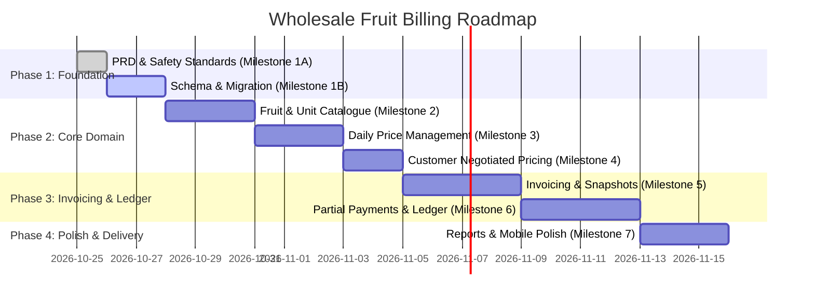

# Product Requirements Document (PRD)
## Wholesale Fruit Billing Manager

**Document Version:** 1.0.0  
**Project:** Wholesale Fruit Billing Adaptation (`smart-billing`)  
**Status:** Approved for Implementation  
**Target Domain:** Wholesale Fruit Commission Agents, Mandi Merchants, and Fresh Produce Distributors  

---

## 1. Executive Summary & Vision

The **Wholesale Fruit Billing Manager** adapts and enhances the core SmartBilling platform into an end-to-end, multi-tenant billing, ledger, and pricing solution tailored specifically for the wholesale fresh fruit trading business.

Wholesale fruit trading (such as in APMC markets and agricultural mandis) operates under unique operational dynamics:
- **Daily Market Fluctuations:** Fruit rates vary day-to-day based on morning arrivals, supply, quality, and market demand.
- **Multiple Units of Measure (UOM):** Produce is bought and sold in varied units—Kilograms (kg), Crates (crt), Boxes, Bags, Dozens, Quintals, and Metric Tons—often with fractional weights (e.g., 23.450 kg).
- **Customer-Specific Contract/Negotiated Pricing:** Regular buyers (retailers, hotels, institutions) negotiate fixed or concessionary rates that must remain steady even when the open daily market board rate changes.
- **Credit Culture & Running Ledgers:** Sales are heavily credit-driven; customers make daily purchases and issue frequent partial payments (cash, UPI, cheques). A running account ledger with exact outstanding balances is mandatory.
- **Speed & Usability in Fast-Paced Environments:** The system must function smoothly on mobile devices (Android smartphones and tablets) directly in noisy mandi environments, as well as on desktop computers for back-office administration.

---

## 2. User Personas

| Persona | Role | Key Needs |
| :--- | :--- | :--- |
| **Wholesale Merchant / Admin** | Business owner, commission agent, or head cashier. | Quick morning price board updates; rapid invoice creation; real-time customer ledger & collection tracking; sales summaries. |
| **Billing Operator** | Mandi floor worker or cashier. | Fast entry on mobile or tablet; barcode/search fruit lookup; automatic application of negotiated rates; instant invoice generation and WhatsApp/SMS share or thermal print. |
| **Wholesale Buyer / Client** | Retail shop owner, supermarket procurement manager, or restaurant supplier. | Clear invoices displaying fruit variety, weight, UOM, and rate; transparent ledger statements showing previous balance, new bill, payments made, and current balance. |

---

## 3. Core Requirements & Functional Specifications

### 3.1. Authentication, Business Isolation & Multi-Tenancy
- **Secure Authentication:** Multi-tenant credential-based login powered by NextAuth v5 with Argon2id password hashing and JWT sessions.
- **Tenant Isolation:** Every operational entity (`Fruit`, `FruitUnit`, `DailyFruitPrice`, `CustomerFruitPrice`, `Client`, `Invoice`, `Payment`, `Expense`, `Settings`) must be strictly partitioned by `userId`.
- **Zero Cross-Tenant Access:** All database read/write queries must enforce server-side tenancy scoping (`where: { userId: session.user.id }`). URL tampering (e.g., guessing another tenant's client ID or invoice ID) must result in a `404 Not Found` or `401/403`.
- **Demo Credential Gating:** Remove hardcoded demo credentials from production UI; enable demo pre-fill only in development mode.

### 3.2. Business Settings & Onboarding
- **Company Profile:** Business name, trade name, APMC / Mandi market license number, GSTIN (optional/mandatory based on turnover), registered address, and contact numbers.
- **Financial Defaults:** Currency (default `INR` - ₹), tax label (e.g., `GST`, `Mandi Cess`), default tax rate (often 0% for unprocessed fresh fruits, or specified cess/tax rate), invoice numbering prefix (e.g., `WF-`, `APMC-`).
- **Branding & Print Configuration:** Company logo upload, header accent color, default terms/bank details for NEFT/UPI, and print layout format options (Standard A4 PDF and Compact 80mm Thermal Receipt format).

### 3.3. Fruit Catalogue & Configurable Units
- **Unit of Measure (UOM) Management:**
  - Configurable master list of units: Kilogram (`kg`), Crate (`crt`), Box (`box`), Bag (`bag`), Dozen (`doz`), Quintal (`qtl`), Metric Ton (`mt`).
  - Unit code, full display name, and decimal precision rules.
  - Ability to set a default unit per business.
- **Fruit / Produce Master Catalogue:**
  - Fields: Name (e.g., "Apple", "Mango", "Banana"), Variety/Grade (e.g., "Kashmiri Delicious", "Alphonso Grade A", "Robusta"), Category (e.g., Citrus, Pome, Tropical, Berries), HSN Code (e.g., 0808 for Apples), Default Unit (FK to `FruitUnit`), and Active Status.
  - Quick search and filtering by name, variety, and category.

### 3.4. Daily Fruit-Price Management Dashboard
- **Daily Market Price Board:**
  - Dedicated admin screen allowing the merchant to review and set daily base rates for all active fruits in their catalogue.
  - Effective Date selection (defaults to today `YYYY-MM-DD`).
  - **Bulk Price Editor:** Inline grid or spreadsheet-style editing allowing rates for 20+ fruits to be updated and saved in a single database transaction in under 30 seconds.
  - **Historical Price Tracker:** Audit log and visual price history per fruit, enabling users to look back at price movements over 7, 30, and 90 days.

### 3.5. Customer-Specific Negotiated Prices
- **Customer Pricing Overrides:**
  - Ability to link a specific customer (`Client`) with a specific `Fruit` and `FruitUnit` at an agreed fixed rate (e.g., "Client SuperMart gets Kashmiri Apple @ ₹120/kg").
  - **Invariance Rule:** When default daily fruit prices change on the main board (e.g., Kashmiri Apple jumps to ₹135/kg), the customer's negotiated price **must remain untouched at ₹120/kg**.
  - Validity range: Optional `effectiveFrom` and `effectiveTo` dates.
  - Dedicated tab within Client Details to view, add, modify, or expire negotiated rates.

### 3.6. Invoice Creation & Dynamic Price Resolution
- **Price Hierarchy (Resolution Flow):**
  When adding a fruit line item for a customer on an invoice:
  1. **Tier 1 (Customer Negotiated):** Check for an active `CustomerFruitPrice` for that customer, fruit, and unit on the invoice date.
  2. **Tier 2 (Daily Board Price):** If no negotiated price exists, fetch the `DailyFruitPrice` for that fruit and unit for the invoice date (or the most recent preceding effective date).
  3. **Tier 3 (Catalog Default / Manual):** If neither exists, prompt the user to input the unit price.
- **Invoice-Only Price Overrides:**
  - The operator can manually override the unit price for that specific invoice item (e.g., clearing out damaged crates at a discount).
  - An invoice-level override modifies **only** that invoice item and does not change the customer's contract rate or the daily board price.

### 3.7. Historical Invoice Snapshots & Immutability
- **Immutable Item Snapshot:**
  - The `InvoiceItem` record must persist an exact snapshot of:
    - Fruit ID and current Name at the time of sale
    - Unit ID and Unit Code/Name snapshot
    - Unit Price applied
    - Quantity / Weight sold
    - Pre-tax and Post-tax calculations
  - Future edits to the Fruit Catalogue or Daily Price Board **must never rewrite past invoices**.
- **Finalized Invoice Protection:**
  - Invoices marked `PENDING`, `PARTIALLY_PAID`, or `PAID` cannot be silently recalculated. Any modification requires an explicit revision or void action with an audit log entry.

### 3.8. Decimal Quantities, Discounts, and INR Financial Calculations
- **Fractional Precision:**
  - Fruit weights must support high-precision decimals (`Decimal(10, 3)`), supporting fractional weights down to 1 gram (e.g., `18.425 kg`).
  - Financial amounts (subtotals, taxes, discounts, totals) must use exact `Decimal(12, 2)` representations to eliminate IEEE-754 floating-point rounding errors.
- **Discounts:**
  - Support flat rupee discounts (e.g., ₹250 off round-off) or percentage discounts (e.g., 2% cash discount).
- **Indian Rupee (INR) Formatting:**
  - Comma grouping conforming to Indian numbering convention (e.g., `₹1,45,250.50`).

### 3.9. Partial Payments, Customer Ledger & Receipts
- **Customer Account Ledger:**
  - Each customer maintains a running ledger of all debits (invoices issued) and credits (payments made, credit notes).
  - Real-time calculation of **Current Outstanding Balance** (`Total Invoiced - Total Collected`).
- **Partial Payments Management:**
  - Recording of partial payments against a specific invoice or on-account towards the overall customer balance.
  - Supported payment methods: `CASH`, `UPI` (Google Pay, PhonePe, Paytm), `NEFT/RTGS`, `CHEQUE`.
  - Payment details: Reference / UTR number, cheque date/clearing date, payment date, and cashier notes.
- **Payment Statuses on Invoices:**
  - `DRAFT`: Editable draft bill.
  - `PENDING`: Finalized bill issued, zero payment received.
  - `PARTIALLY_PAID`: Finalized bill with `0 < paidAmount < totalAmount`.
  - `PAID`: Fully settled (`paidAmount == totalAmount`).
  - `VOID`: Cancelled invoice.
- **Receipts & Statements:**
  - Downloadable and printable **Payment Receipts** with unique receipt numbers.
  - Downloadable **Customer Account Statement** (PDF and CSV) showing opening balance, date-wise debit/credit ledger, and closing balance.

### 3.10. Reports, CSV Exports & Responsive Mobile UI
- **Wholesale Reports:**
  - **Daily Fruit Sales Summary:** Total quantity and value sold per fruit and variety for any selected date range.
  - **Daily Collection Report:** Total cash, UPI, and bank collections received today.
  - **Customer Outstanding & Aging Report:** List of all customers with pending dues, categorized by 0-7 days, 8-15 days, 16-30 days, and 30+ days overdue.
- **Data Export:**
  - One-click CSV and Excel-friendly export for Invoices, Ledgers, Daily Prices, and Fruit Sales.
- **Responsive UI (Mobile & Desktop):**
  - **Android / Mobile Mandi Mode:** Touch-friendly buttons, clear contrast for outdoors, large numeric keypad support for rapid weight entry, and collapsible sidebar.
  - **Desktop Mode:** Dense data tables, keyboard shortcuts, and dual-pane views for high-volume back-office billing.

---

## 4. Acceptance Criteria

| ID | Feature | Acceptance Criteria |
| :--- | :--- | :--- |
| **AC-01** | Multi-Tenancy Isolation | No tenant can view, query, or mutate fruits, prices, clients, invoices, or payments belonging to another tenant. |
| **AC-02** | Configurable Units | Admin can define custom units (kg, crt, box, etc.); units seamlessly appear in fruit catalogue and invoice entry. |
| **AC-03** | Decimal Weight Precision | Operator can create an invoice item with `14.650 kg` @ `₹82.50/kg`; calculations accurately yield `₹1,208.63` without floating-point errors. |
| **AC-04** | Daily Price Bulk Update | Admin can update prices for 20 fruits for a specific date in a single request; price history preserves previous dates. |
| **AC-05** | Customer Price Invariance | Changing the daily board price of Apples from ₹100 to ₹120 does NOT alter Client A's negotiated price of ₹95. |
| **AC-06** | Invoice Auto-Resolution | Selecting a client and fruit on invoice creation automatically applies the customer's negotiated price if active; otherwise applies today's daily board rate. |
| **AC-07** | Partial Payment & Ledger | An invoice for ₹10,000 receiving a ₹4,000 cash payment transitions to `PARTIALLY_PAID`; client's outstanding balance correctly reflects ₹6,000. |
| **AC-08** | Invoice PDF & Print | PDF shows fruit name, variety, unit code, exact decimal quantity, rate, tax, and previous balance / current balance block. |
| **AC-09** | Mobile Usability | Invoicing and daily price updates are fully functional on Android mobile viewports (360px - 412px width). |

---

## 5. Milestone-Based Implementation Plan

- **Milestone 1A (Current):** Project Documentation and Safety Preparation (PRD, Skill Rules, Safe `.env.example`).
- **Milestone 1B:** Database Schema Migration (`FruitUnit`, `Fruit`, `DailyFruitPrice`, `CustomerFruitPrice`, `Payment`, updated `InvoiceItem` decimal quantity, and relations).
- **Milestone 2:** Fruit & Unit Catalogue Management (UI & API for master fruit records and units).
- **Milestone 3:** Daily Price Management (Admin bulk price updater, historical price logs).
- **Milestone 4:** Customer-Specific Pricing (Client negotiated rates and price priority resolver).
- **Milestone 5:** Wholesale Invoicing Engine (Decimal weight entry, item snapshots, printable fruit invoice PDF).
- **Milestone 6:** Partial Payments, Customer Ledger & Receipts (Payment modal, running ledger, account statements).
- **Milestone 7:** Wholesale Reports & Mobile Responsiveness Optimization (Mandi mode, sales summaries, E2E validation).
